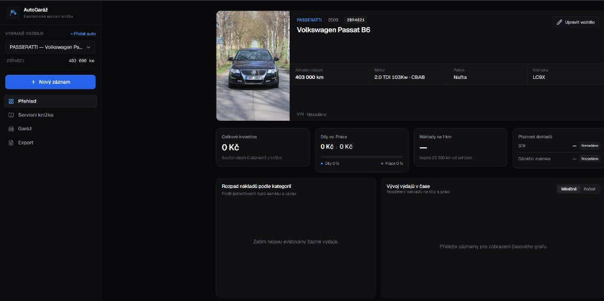

<div align="center">
  
  <h1>AutoGaráž</h1>
  <p><strong>Elektronická servisní knížka &amp; evidence nákladů vozidel</strong></p>
  <p>
    
    
    
    
    
  </p>
</div>

---

**AutoGaráž** je moderní responzivní webová aplikace a PWA navržená pro přehlednou správu vozového parku, evidenci servisních úkonů, sledování platnosti dokladů a detailní analýzu provozních nákladů — kompletně v češtině a v tmavém rozhraní *Refined Obsidian*.

<div align="center">
  
</div>

---

## Hlavní funkce

- **Přehledový dashboard (Bento KPI & Grafy)**
  - Okamžitý přehled celkových investic, poměru nákladů na **Díly vs. Práce**, přepočtu **nákladů na 1 km** a hlídání platnosti **STK, dálniční známky a pojištění**.
  - Interaktivní prstencový graf rozpadu podle kategorií a sloupcový graf vývoje výdajů v čase (měsíčně / ročně).
  - Rychlý přehled posledních 5 servisních záznamů.
- **Elektronická servisní knížka**
  - Evidence servisních zásahů s rozlišením kategorií (*Pravidelný servis*, *Oprava*, *Úpravy / Tuning*, *Detailing & Péče*, *Pneumatiky & Kola*, *Administrativa / STK / Poplatky*).
  - Ukládání OEM kódů dílů, odkazů na produkty, nájezdu v km a poznámek.
  - Fulltextové vyhledávání, filtrování podle kategorií a detailní náhled záznamu.
- **Fotogalerie & komprese médií**
  - Nahrávání úvodní fotografie vozidla i příloh (faktur, fotek dílů) přímo k servisním záznamům.
  - Automatická klientská komprese obrázků před nahráním do soukromého Supabase Storage bucketu (`garage-media`) a celoobrazovkový lightbox.
- **Správa více vozidel (Garáž)**
  - Rychlé přepínání mezi vozidly z postranního panelu i mobilní hlavičky, kopírování VIN jedním kliknutím.
- **Export & tisk do PDF**
  - Dedikovaný tiskový pohled (`@media print`) pro čistý export kompletní servisní historie do PDF při prodeji vozu nebo pro vlastní archiv.
- **Mobilní PWA & ukázkový režim**
  - Podpora instalace na plochu iOS/Android (`manifest.json`, bezpečné zóny `viewport-fit=cover`) a spodní navigace pro ovládání jednou rukou.
  - Funguje i bez napojeného backendu v lokálním ukázkovém režimu (`localStorage`).

---

## Technologický stack

| Vrstva | Technologie |
| :--- | :--- |
| **Framework** | Next.js 16.4 (App Router, Turbopack), React 19, TypeScript |
| **Stylování & UI** | Tailwind CSS v4, Radix UI, vlastní Obsidian design systém |
| **Vizualizace & Ikony** | Recharts, Lucide React |
| **Databáze & Auth** | Supabase (PostgreSQL, Row Level Security, Email/Password + Magic Link) |
| **Úložiště médií** | Supabase Storage (`garage-media`, soukromý bucket s RLS) |

---

## Struktura projektu

```text
src/
├── app/
│   ├── layout.tsx              # Kořenový layout, Geist fonty, PWA metadata
│   ├── page.tsx                # Vstupní bod aplikace
│   ├── prihlaseni/page.tsx     # Přihlášení, registrace a Magic Link
│   └── globals.css             # Obsidian design tokens & print pravidla
├── components/
│   ├── garage-app.tsx          # Hlavní shell (desktop sidebar + mobilní navigace)
│   ├── dashboard-view.tsx      # Bento KPI, Recharts grafy, poslední aktivita
│   ├── service-log-view.tsx    # Vyhledávatelná servisní knížka
│   ├── garage-view.tsx         # Karta garáže a správa vozidel
│   ├── export-view.tsx         # Tiskový výstup do PDF
│   ├── vehicle-header.tsx      # Kompaktní hlavička vozu s VIN a parametry
│   └── ui/                     # Znovupoužitelné UI komponenty
├── lib/
│   ├── garage-store.ts         # Stavová vrstva (Supabase + lokální fallback)
│   ├── format.ts               # Formátování Kč, km, dat a expirací
│   ├── image-compression.ts    # Klientská komprese nahraných fotografií
│   └── supabase/               # Browser, Server a Middleware klienti
└── types/database.ts           # TypeScript typy pro DB entity
supabase/
└── schema.sql                  # Kompletní SQL schéma, triggery a RLS politiky
```

---

## Rychlé lokální spuštění

1. **Naklonujte repozitář a nainstalujte závislosti:**
   ```bash
   git clone https://github.com/Andreyy05/AutoGarage.git
   cd AutoGarage
   npm install
   ```

2. **Spusťte vývojový server:**
   ```bash
   npm run dev
   ```
   Aplikace bude dostupná na [http://localhost:3000](http://localhost:3000). Bez nastaveného `.env.local` se automaticky spustí v lokálním ukázkovém režimu.

3. **Další dostupné skripty:**
   ```bash
   npm run build   # Produkční build
   npm run start   # Spuštění produkčního serveru
   npm run lint    # Kontrola kódu přes ESLint
   ```

---

## Napojení na Supabase (produkční databáze)

1. Vytvořte nový projekt na [supabase.com](https://supabase.com).
2. V **SQL Editoru** spusťte celý skript ze souboru [`supabase/schema.sql`](./supabase/schema.sql).
   - Skript založí tabulky `vehicles`, `service_records`, `record_photos`, nastaví **Row Level Security (RLS)** politiky pro izolaci dat jednotlivých uživatelů a vytvoří soukromý Storage bucket `garage-media`.
3. Zkopírujte šablonu proměnných prostředí:
   ```bash
   cp .env.example .env.local
   ```
   a doplňte hodnoty ze sekce *Project Settings → API*:
   ```env
   NEXT_PUBLIC_SUPABASE_URL=https://vas-projekt.supabase.co
   NEXT_PUBLIC_SUPABASE_ANON_KEY=vas-publishable-nebo-anon-klic
   ```
4. Restartujte server a přihlaste se na `/prihlaseni`.

---

## Nasazení na Vercel

1. Importujte repozitář **`Andreyy05/AutoGarage`** na [vercel.com/new](https://vercel.com/new).
2. V sekci **Environment Variables** přidejte:
   - `NEXT_PUBLIC_SUPABASE_URL`
   - `NEXT_PUBLIC_SUPABASE_ANON_KEY`
3. Klikněte na **Deploy** — Vercel automaticky detekuje Next.js a aplikaci nasadí.
